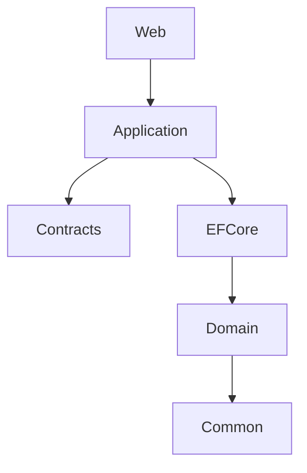

# Project: StandardWeb

## Overview

ASP.NET Core Web API template (`dotnet new micake-webapi`, .NET 11) on the MiCake DDD framework. Ships two contexts — Identity (phone/email registration, password login, JWT access + refresh tokens) and Configuration (typed, optionally encrypted `AppSetting`) — over EF Core/PostgreSQL, with Serilog, Scalar/OpenAPI, FluentValidation, AutoMapper and xUnit tests.

## Core Terms

| Term | Meaning |
|---|---|
| `MiCakeModule` | Framework module; `[RelyOn]` sets startup order |
| `AuditAggregateRoot` / `AuditEntity` | Aggregate-root base (long Id + audit fields) / child-entity base (audit fields) |
| `RecordValueObject` | Marker base for immutable `record` value objects |
| `[InjectService]` / `AutoRegisterRepositories` | Discovery-based DI registration |
| `[UnitOfWork]` | Action filter running the action inside a transactional UoW |
| `OperationResult` / `OperationResult<T>` | Service result: IsSuccess, ErrorCode, ErrorMessage, Data |
| `ApiResponse` | HTTP envelope: Code, Message, Data |
| `ModuleCode` | Two-digit module prefix on every code, e.g. `01.1000` |
| `InfrastructureTools` | Scoped controller helper exposing `IMapper` and `ILoggerFactory` |
| `AppSetting` | Aggregate root: SettingGroup + Key to a typed, optionally encrypted value |
| `SettingGroup` | Email, Sms, Payment, System, Security, Storage, Notification, Integration |
| `ContactInfo` / `Password` / `PersonalInfo` | User value objects; ContactInfo needs phone or email; Password never prints its hash |
| `User` | Aggregate root: Contact, Credential, Profile, lockout state, OTP flag |
| `UserToken` / `UserLoginHistory` / `ExternalLoginProvider` | User child entities: per-type token with expiry, login attempt record, third-party binding |
| `UserStatus` | Inactive=0, Active=1, Frozen=2 |
| `DataEncrytionPurpose` | Data Protection purpose constants (identifier intentionally spelled "Encrytion") |

## Module Structure

| Module | Path | Responsibility | Depends on |
|---|---|---|---|
| Common | `StandardWeb.Common` | OperationResult, cache, JWT models/claims, helpers, Data Protection wrapper | `MiCakeRootModule` |
| Domain | `StandardWeb.Domain` | Aggregates, value objects, enums, repository interfaces | Common |
| EFCore | `StandardWeb.EFCore` | `AppDbContext`, mappings/indexes, repository implementations | Domain, `MiCakeEFCoreModule` |
| Application | `StandardWeb.Application` | Services, JWT provider, mappers, error codes, audit provider | EFCore |
| Contracts | `StandardWeb.Contracts` | Client-facing DTOs and enums | none |
| Web | `StandardWeb.Web` | Host, controllers, validators, module codes, JWT/CORS/HttpClient setup | Application, `MiCakeAspNetCoreModule` |

Aggregate roots `User` and `AppSetting`; value objects `ContactInfo`, `Password`, `PersonalInfo`; child entities `UserToken`, `UserLoginHistory`, `ExternalLoginProvider`; Contracts DTOs `UserDto`, `UserRegistrationDto`, `LoginRequestDto`, `LoginResultDto`, `AppSettingDto` family; Web-only `RefreshTokenRequestDto`, `QueryUserListDto` with validators.

`tools/EfCoreMigrationApp` applies migrations and runs `ISeedService` implementations (e.g. `AppSettingSeedService`).

## Layer Structure

- Direction: Web → Application → {Contracts, EFCore} → Domain → Common.
- Forbidden: Common → any other project; Domain → EFCore/Application/Web; EFCore → Application/Web; Contracts → Domain or infrastructure.
- Startup order via `[RelyOn]`: Common → Domain → EFCore → Application → Web.
- Controllers never use `DbContext`; read paths may use the aggregate's own repository (`IUserRepo`).
- Encryption and caching live in Application; `AppSetting` stores already-encrypted values.

## Key Business Rules

Registration and login:
- At least one contact method required; phone checked by `FormatChecker.IsValidPhoneNumber`; duplicate phone or email rejected (`UserAlreadyExists`).
- Password stored as a BCrypt hash; `Password.Create` rejects an empty hash.
- 5 failed attempts (`MaxLoginAttempts`) set `ForceOTPOnLogin`.
- `IsLockedOut()` = `LockoutEnabled && LockoutEnd > now`; `LockAccount` rejects non-positive durations; `UnlockAccount` clears the lock and counter.
- Passwordless (external-only) accounts fail login with `InvalidCredentials`.
- `ForceOTPOnLogin` without an OTP returns `NeedOtpVerification = true, LoginPassed = false` instead of tokens.
- Success resets `AccessFailedCount`; failure increments it.
- Refresh tokens are stored as `UserTokenType.JwtRefreshToken`; unknown or expired → `InvalidToken`; locked-out users cannot refresh.
- Removing the last remaining login method is rejected.
- Uniqueness: `ExternalLoginProvider`(`UserId`,`ProviderType`,`ProviderKey`), `UserToken`(`UserId`,`Type`).

Configuration:
- `AppSetting` unique on (`SettingGroup`,`Key`); Key ≤ 100, Description ≤ 500, ValidationPattern ≤ 500; Value non-empty.
- A set `ValidationPattern` is enforced on create and on every update; an invalid regex makes validation return false; changing the pattern re-validates the current value.
- `IsEncrypted` means Application encrypts before store and decrypts on read; encryption failure aborts the write.
- Reads cached for `CacheSettings:AppSettingsCacheDurationMinutes` (default 10) and invalidated on create/update/delete/batch update.
- Batch upsert is per item: counts Created/Updated/Failed, collects per-key errors, never aborts the batch.
- `PUT api/appsettings/{group}/{key}` requires route values to match the body.

Cross-cutting:
- Responses are always `ApiResponse` with `Code = "{ModuleCode}.{code}"`; 01 auth `1000`–`1006`, 05 configuration `1101`–`1110`, generic `9900/9901/9902/9998/9999`.
- Creation returns HTTP 200 with `Data`, not 201, despite `ProducesResponseType` declaring 201.
- Login validator messages are Chinese.
- No controller declares `[Authorize]`: all endpoints are anonymous; JWT is configured but not enforced per endpoint.

## API Overview

| Controller | Routes (prefix noted) |
|---|---|
| AuthController `api/auth` | POST `register` (`[UnitOfWork]`, `UserRegistrationDto`), POST `login` (`LoginRequestDto` → `LoginResultDto`), POST `token/refresh` (`RefreshTokenRequestDto`) |
| UserController `api/user` | GET `{id}` (`UserDto`, 400 `9902` if absent), GET `paged` (`pageIndex`, `pageSize`, `QueryUserListDto`) |
| AppSettingsController `api/appsettings` | GET `{group}`, GET `{group}/{key}` (bypasses cache), POST, POST `batch`, PUT `{group}/{key}`, DELETE `{group}/{key}` |

Services: `AuthService.RegisterAsync|LoginByPhoneAsync|RefreshTokenAsync` (shared logic in `BaseLoginService`); `AppSettingService` create/update/delete/batch-upsert plus `GetSettingValueAsync<T>`, `GetGroupSettingsAsync`, `GetGroupValuesAsync`, `GetGroupAsObjectAsync<T>`, `GetSettingWithoutCacheAsync`, `InvalidateCacheAsync`; `JwtProvider.GenerateToken(User, List<Claim>)` → `JwtTokenModel` (HS256, `Jwt` config section). CLI: `tools/EfCoreMigrationApp`.

Host: `Program.cs` calls `AddWebApiDefaults`, `AddNpgsql<AppDbContext>`, `AddMiCakeWithDefault<WebModule, AppDbContext>`, `RegisterHttpClients`, `AddJWTAuthentication`, `AddCorsPolicy` (policy `CorsPolicy`), `AddDistributedMemoryCache`; OpenAPI/Scalar only in Development; scheme `Bearer`.

# Project: RBACWeb

## Overview

The same WebAPI template plus an RBAC context: roles, permissions, resources, data scopes, user-role assignment, dynamic policy-based authorization, and cached permission/data-scope resolution. Identity, Configuration, Common, Contracts and host wiring are otherwise identical to StandardWeb; only deltas are listed.

## Core Terms

Shared template terms keep the StandardWeb meaning.

| Term | Meaning |
|---|---|
| `Role` | Aggregate root of permissions and data scopes; `IsSystem` roles cannot be deactivated or deleted |
| `Permission` | Aggregate root with unique `Code` (`{resource}:{action}`), optional `ResourceId`, and `PermissionAction` |
| `Resource` | Aggregate root with unique `Code`, self-referencing `ParentId` hierarchy, and `ResourceType` |
| `DataScope` | Aggregate root defining visibility: `DataScopeType`, optional `Condition`, `Priority` |
| `RolePermission` / `RoleDataScope` | Child links; `RolePermission.IsGranted` means grant or explicit deny |
| `UserRole` | User child link with `AssignedAt`, `ExpiresAt`, `IsActive`; effective when active and unexpired |
| `PermissionAction` | Read=1, Create=2, Update=3, Delete=4, Execute=5, Manage=6, Export=7, Import=8 |
| `ResourceType` / `DataScopeType` | Module/Menu/API/Button/Data = 1–5; All=1, Self=2, Custom=3 |
| `RequirePermissionAttribute` | `AuthorizeAttribute` mapping a permission code to policy `Permission:{code}` |
| `AuthorizationPolicyProvider` + `PermissionAuthorizationHandler` | Materialize `Permission:*` policies and evaluate them through `IPermissionChecker` |
| `IPermissionChecker` / `IDataScopeResolver` | Cached permission/role lookup; resolves `DataScopeFilter` (`Type`, `UserId`, `Condition`, `HasFullAccess`, `IsSelfOnly`) |

## Module Structure

Deltas on the StandardWeb module table:

- Domain: `RBACWeb.Domain/Models/Authorization` holds `Role`, `Permission`, `Resource`, `DataScope` plus `RolePermission`, `RoleDataScope`; Identity gains `UserRole`.
- Application: `Authorization/` (`IPermissionChecker`/`PermissionChecker`, `IDataScopeResolver`/`DataScopeResolver`) and `Services/Authorization/` (`RoleService`, `PermissionService`, `ResourceService`, `DataScopeService`, `UserRoleService`).
- Web: `Authorization/` holds the attribute, requirement, policy provider and handler. Contracts: `Dtos/Authorization` (Role, RoleDetail, Create/Update, Assign*, Permission, Resource, DataScope, UserRole, UserPermissions) and `Enums`.
- EFCore: `AppDbContext` adds `Roles`, `Permissions`, `Resources`, `DataScopes`.

## Layer Structure

The StandardWeb diagram applies, plus one edge: `Web/Authorization` (attribute, policy provider, handler) → `Application/Authorization` (`PermissionChecker`, `DataScopeResolver`) → `Domain/Repositories` (`IRoleRepo`, `IPermissionRepo`, `IResourceRepo`, `IDataScopeRepo`).

- Web authorization code must not query `AppDbContext`; Domain must not reference ASP.NET Core authorization types.

## Key Business Rules

Identity, Configuration and cross-cutting rules match StandardWeb; add module code `06` with authorization codes `2000`–`2050`.

- Uniqueness: `Permission.Code`, `Resource.Code`, `DataScope.Code`; `UserRole`(`UserId`,`RoleId`), `RolePermission`(`RoleId`,`PermissionId`), `RoleDataScope`(`RoleId`,`DataScopeId`).
- `Role.Create` rejects empty names; `IsSystem` roles cannot be deactivated, and role deletion is a soft deactivate that fails with `RoleIsSystem`.
- `Role.AddPermission` rejects duplicates; `HasPermission` counts granted links only; `Permission.ResourceId`, when set, must be positive.
- `DataScopeType.Custom` requires a non-empty `Condition` (validated on create and update); a `Resource` cannot be its own parent.
- `AssignPermissionsAsync` / `AssignDataScopesAsync` are full replacements: every id must exist (otherwise the whole call fails), links absent from the request are removed, then the role cache is invalidated.
- Role assignment needs positive ids, an existing role and a future `ExpiresAt`; duplicates return `UserRoleAlreadyAssigned`; removing a non-assigned role returns `UserRoleNotFound`.
- Effective permissions: no roles means none; only granted links on active permissions count; de-duplicated by permission id.
- Effective data scope: inactive scopes dropped; highest `Priority` wins, ties broken by ascending `Type` (All beats Self); no scope means `Self`.
- Cache, 5 min each: `user:roles:{userId}`, `user:permissions:{userId}:{version}`, `user:datascopes:{userId}`. A role change bumps the global `user:permissions:version` (1 day TTL), invalidating all permission entries; a user-role change invalidates that user's two keys.
- The handler runs before MiCake's action-filter UoW, so it opens its own `UnitOfWorkOptions.ReadOnly` UoW; permission queries must not rely on an ambient UoW.
- Unauthenticated requests fail silently (no `context.Succeed`), yielding a standard 401/403.
- Bundled controllers use `[Authorize]` only; `[RequirePermission("code")]` is the intended per-permission enforcement but is not applied, so decorating actions is required.
- `PermissionAction`, `ResourceType` and `DataScopeType` are declared twice with identical members (`RBACWeb.Contracts.Enums` and `RBACWeb.Domain.Enums.Authorization`); new members must be added to both.

## API Overview

Identity and Configuration endpoints match StandardWeb. All controllers use `[Route("api/[controller]")]` (literal `role`, `permission`, `resource`, `datascope`) and `[Authorize]`.

| Controller | Routes |
|---|---|
| RoleController `api/role` | GET ``, GET `{id}`, POST ``, PUT `{id}`, DELETE `{id}`, POST `{id}/permissions`, POST `{id}/datascopes` |
| PermissionController `api/permission` | GET ``, GET `{id}`, GET `by-resource/{resourceId}`, POST ``, PUT `{id}`, DELETE `{id}` |
| ResourceController `api/resource` | GET ``, GET `tree`, GET `{id}`, POST ``, PUT `{id}`, DELETE `{id}` |
| DataScopeController `api/datascope` | GET ``, GET `{id}`, POST ``, PUT `{id}`, DELETE `{id}` |
| UserRoleController `api/users/{userId}/roles` | GET ``, GET `permissions`, POST ``, DELETE `{roleId}` |

Services: `IPermissionChecker` (`HasPermissionAsync`, `GetUserPermissionCodesAsync`, `GetUserPermissionsAsync`, `GetUserRolesAsync`, `GetUserRoleIdsAsync`, `InvalidateUserCacheAsync`, `InvalidateRoleCacheAsync`); `IDataScopeResolver` (`GetDataScopeAsync`, `GetUserDataScopesAsync`, `HasFullAccessAsync`).

Host: `AddJWTAuthentication` also calls `AddRBACAuthorization`, registering `AuthorizationPolicyProvider` (singleton `IAuthorizationPolicyProvider`) and `PermissionAuthorizationHandler` (scoped `IAuthorizationHandler`).
